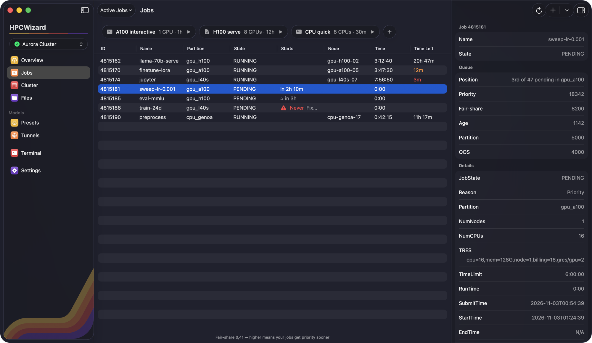
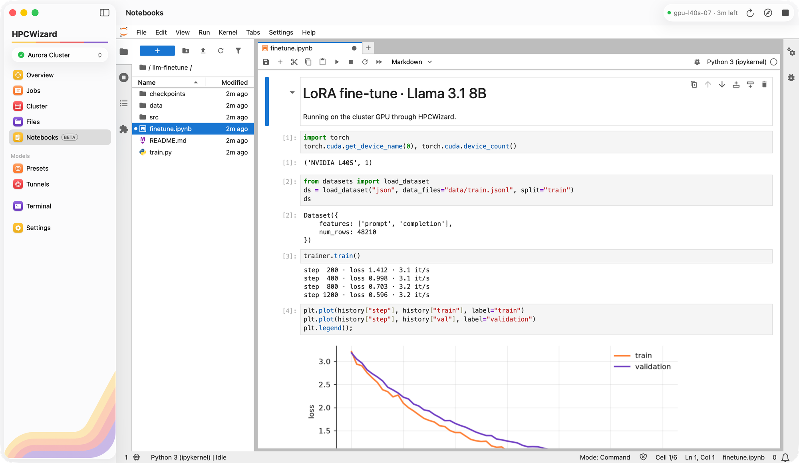

  

<h1 align="center">HPCWizard</h1>

  <b>Clusters, made friendly.</b> 
  A native Mac app for HPC clusters: submit jobs, get GPUs, move files, run JupyterLab notebooks (beta) 
  and tunnel to anything running on a node — on any Slurm cluster you can reach over SSH.

  
  
  

  

---

**[Visit the website →](https://andreasillano.github.io/HPCWizard-release/)** for features, screenshots and the FAQ.

### New in 0.3.0: Notebooks (beta)

JupyterLab on a cluster GPU, right inside the app: pick an image, choose your GPUs and press Start. It runs in an Apptainer container on the node; nothing else is installed on the cluster.

  

### Install

1. [Download the latest version](https://andreasillano.github.io/HPCWizard-release/downloads/HPCWizard.dmg) and open it.
2. Drag **HPCWizard** onto **Applications**.

The app is signed and notarized by Apple, so it opens like any other app.

HPCWizard updates itself: it checks once a day and asks before installing.

This repository hosts the website, the update feed (`appcast.xml`) and the downloads.
